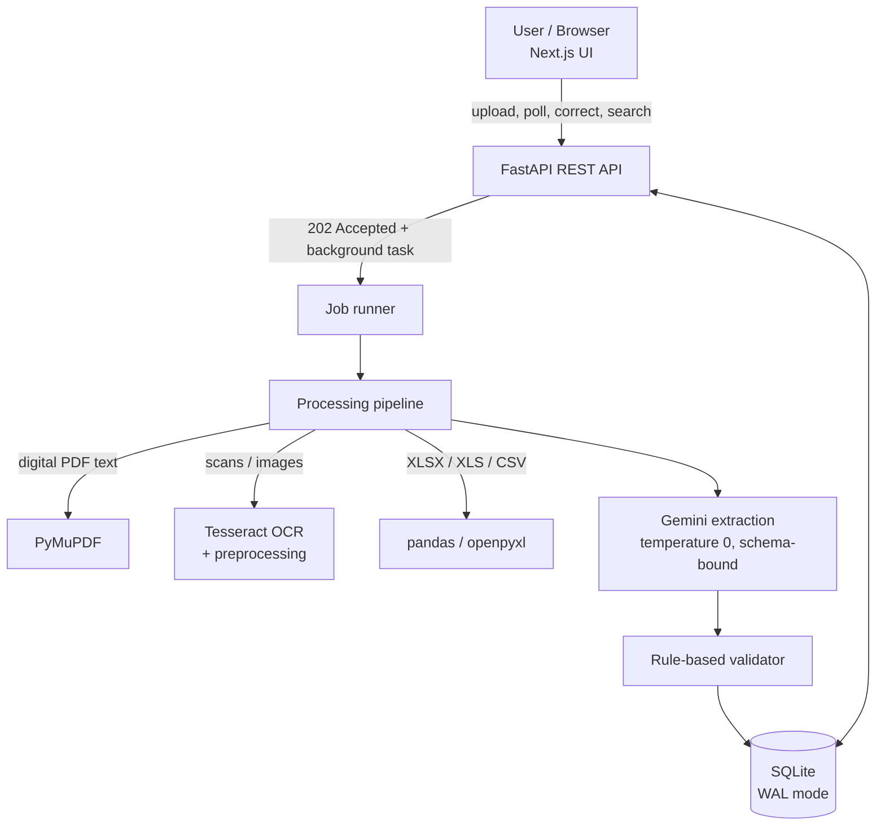

# AI-Powered Document Intelligence System

Upload invoices as **PDF, JPG, PNG, TIFF, XLSX, XLS or CSV**. The system reads them (with OCR when needed), extracts structured data with an LLM that is **never allowed to invent values**, validates the result with deterministic rules, stores everything, and lets a human review and correct what looks wrong.

> Built as a hiring assessment. Everything is runnable locally with free tools only (Gemini free tier, Tesseract, SQLite).

## Why it is built this way

| Principle | How it shows up |
|---|---|
| **Never invent data** | Extraction schema is all-optional; the model must return `null` when unsure and list `uncertain_fields`. Totals are never recomputed by the AI. |
| **AI proposes, rules verify** | A separate rule-based validator (no AI) checks arithmetic, dates, duplicates and OCR quality. |
| **Humans stay in control** | Anything suspicious becomes `needs_review`. A reviewer corrects values in the UI. |
| **Auditability** | The AI's original answer is never overwritten (`data_json`); corrections are stored separately (`corrected_json`); every step is logged in `processing_events`. |
| **One bad file never breaks the system** | Every failure is caught, stored on the document as `failed` with a readable message, and can be reprocessed. |

## Architecture



**Request flow**

1. `POST /documents` validates the real file type (magic bytes, not the extension), enforces size limits, stores the file under a random name, creates a `queued` record and returns **202 immediately**.
2. A background job runs: detect type -> read text (PDF text / OCR / spreadsheet) -> LLM extraction -> validation -> save -> final status (`completed` or `needs_review`; `failed` on any error).
3. The UI polls (only while something is queued or processing) and shows progress, extracted data, validation issues and a correction form.

## Data model (SQLite)

| Table | Purpose | Key columns |
|---|---|---|
| `documents` | One row per uploaded file | `id`, `file_name`, `stored_path`, `file_type`, `status` (`queued`/`processing`/`completed`/`needs_review`/`failed`), `error_message`, `page_count`, `ocr_confidence`, `needs_review`, timestamps |
| `extractions` | One row per document | `document_id` (unique, FK), `extracted_text`, `data_json` (**AI original, never overwritten**), `corrected_json` (human correction, null until corrected), plus searchable copies `invoice_number`, `supplier_name`, `invoice_date`, `total` |
| `validation_issues` | Problems found by the validator | `document_id` (FK), `field`, `code`, `severity`, `message` |
| `processing_events` | Audit trail | `document_id` (FK), `event`, `detail`, `created_at` |

Foreign keys use `ON DELETE CASCADE`. Indexes: `documents(status)`, `extractions(supplier_name, invoice_number)` (fast duplicate detection), and `document_id` on the two child tables. SQLite runs in WAL mode.

## Validation rules

Missing required fields (`invoice_number`, `invoice_date`, `supplier_name`, `total`), invalid dates, due date before issue date, malformed currency, negative amounts, line `quantity x unit_price != amount`, line sum `!= subtotal`, `subtotal + tax != total` (tolerance 0.01), fields the model marked uncertain, low OCR confidence, and duplicate invoices (same supplier + invoice number). Any issue sets the document to `needs_review`.

## REST API

| Method | Path | Description |
|---|---|---|
| `GET` | `/health` | Liveness check |
| `POST` | `/documents` | Upload 1-20 files (max 20 MB each). Returns `202` and processes in the background |
| `GET` | `/documents` | List documents (status filter, pagination) |
| `GET` | `/documents/{id}` | Status, AI data, corrected data, issues, extracted text, event history |
| `GET` | `/search` | Keyword search over file name, supplier, invoice number and extracted text |
| `PATCH` | `/documents/{id}/correction` | Save a human correction; re-validates automatically |
| `POST` | `/documents/{id}/reprocess` | Run the pipeline again (`409` if already running) |

Interactive docs: `http://127.0.0.1:8000/docs`.

## Setup (Windows, also works on Linux/macOS)

**Prerequisites:** Python 3.11+, Node.js 20+, Git, [Tesseract OCR](https://github.com/UB-Mannheim/tesseract/wiki), and a free [Gemini API key](https://aistudio.google.com/apikey).

```bash
git clone https://github.com/talib26-lab/document-intelligence-system.git
cd document-intelligence-system

# backend
python -m venv venv
venv\Scripts\activate            # Linux/macOS: source venv/bin/activate
pip install -r requirements.txt
```

Create a file named `.env` in the project root:

```
GEMINI_API_KEY=your_key_here
# optional:
# TESSERACT_CMD=C:\Program Files\Tesseract-OCR\tesseract.exe
# DATABASE_PATH=data/documents.db
# UPLOAD_DIR=data/uploads
```

Run the backend (port 8000):

```bash
python -m uvicorn backend.app.main:app --reload
```

Run the frontend in a second terminal (port 3000):

```bash
cd frontend
npm install
npm run dev
```

Open `http://localhost:3000`.

## Tests

```bash
python -m pytest -q
```

76 automated tests (repository, job runner, REST API, validator rules). They use a temporary database and a **fake extractor**, so they need no network and no API key.

## Evaluation (real, measured)

`evaluation/` contains a reproducible, **fabricated** labelled dataset (21 files: digital PDFs, scans of three quality levels, CSV, XLSX, deliberate errors, corrupt and unsupported files) with the correct answer for every file.

```bash
python evaluation/generate_dataset.py     # recreate the dataset (fixed seed)
python evaluation/run_evaluation.py       # run the REAL pipeline + Gemini and measure
```

The runner reports field accuracy, hallucination rate (value invented where the truth is null), missed and wrong values, line-item precision/recall, detection of injected errors, false alarms on clean documents, failure handling, and speed. Successful AI answers are cached in `evaluation/results/ai_cache.json`, so results can be reproduced without an API key or quota. See `docs/evaluation_report.md`.

**Measured result (final run, 19 labelled documents):** 97.1% field accuracy (166/171), **0% hallucination** (0/8 fields that should be null), 5/5 injected errors detected, 100% on PDF/CSV/XLSX, and 2/2 broken files failed safely. All 5 wrong values came from one heavily blurred scan, which the system itself flagged for human review. Small synthetic dataset; see the limitations in `docs/evaluation_report.md`.

## Security

- File type verified by **magic bytes**, not by name; unsupported or corrupt files fail safely.
- 20 MB per file (streamed in chunks), max 20 files per request.
- Files are stored under **random names**, so user-supplied names can never cause path traversal.
- CORS limited to `localhost:3000`; secrets only in `.env` (git-ignored, never committed); runtime data git-ignored.
- All SQL is parameterised; search wildcards are escaped.
- Failures return controlled messages instead of stack traces.

## Scalability and reliability: current state and path

| Today (MVP) | Production path |
|---|---|
| FastAPI `BackgroundTasks` | Task queue (Celery/RQ + Redis) with workers scaled independently |
| SQLite (WAL) | PostgreSQL (+ `pgvector` for semantic search); the repository layer is the only code that touches SQL, so the swap is contained |
| Files on local disk | Object storage (S3-compatible) |
| Gemini free tier (about 20 requests/day on `gemini-2.5-flash`) | Paid quota, retry with exponential backoff and a rate-limited queue |
| Polling | WebSocket / server-sent events |

Reliability already in place: retries on AI calls (3 attempts), jobs never raise, failed documents can be reprocessed, full event history per document. The free-tier daily limit was hit during evaluation; that run is kept in `evaluation/results/run1_quota_limited_*` as evidence rather than hidden.

## Known limitations (honest list)

- **Semantic search is implemented, but only lightly evaluated.** `GET /search/semantic` (the "Meaning search" checkbox in the UI) embeds each document with Gemini (`gemini-embedding-001`), stores the vectors in SQLite and ranks by cosine similarity. It is covered by tests with a fake embedder, but its quality has not been measured on the evaluation dataset. It compares against every stored vector, which is fine for thousands of documents, not millions (see the scalability path). Keyword search (SQL `LIKE`) remains available.
- OCR is English only (Tesseract `eng`); heavily blurred scans lose accuracy (see evaluation).
- Evaluation uses a **small synthetic** dataset (21 files); real-world invoices will be harder. Numbers show relative behaviour, not a production guarantee.
- One document type (invoices) is supported in the schema.
- No authentication yet; intended for local/demo use.

## AI-assisted development disclosure

This project was built with the help of an AI assistant (Claude) acting as a guide and pair-programmer: architecture discussion, code drafting and explanation. I ran, tested and verified each step myself, and every code path is covered by tests or by the evaluation. Prompts used **inside** the product (the extraction system prompt) are documented in `docs/`. See `docs/ai_disclosure.md`.

## Project structure

```
backend/app/
  api/          REST endpoints
  db/           schema + repository (only place with SQL)
  processing/   file-type detection, PDF / image (OCR) / spreadsheet readers, pipeline
  extraction/   Pydantic schema + Gemini extractor
  validation/   rule-based validator
  services/     job runner
frontend/       Next.js (TypeScript, Tailwind) UI
evaluation/     dataset generator, evaluation runner, results
tests/          pytest suite
docs/           evaluation report, AI disclosure
```